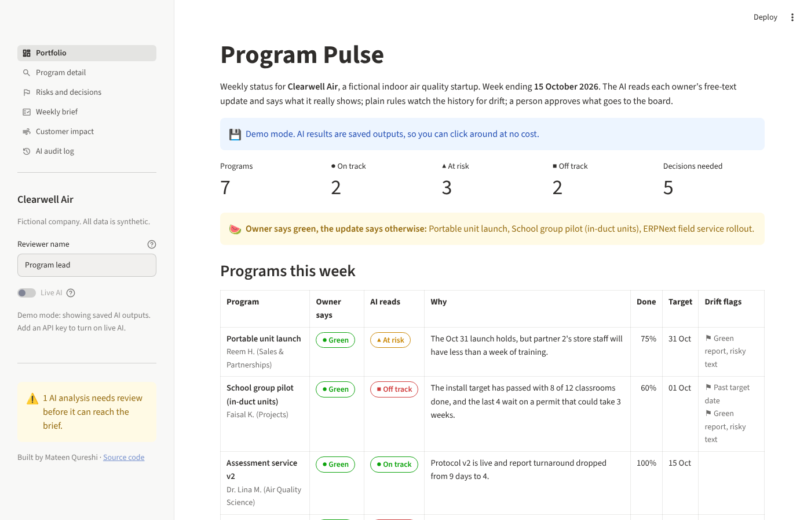
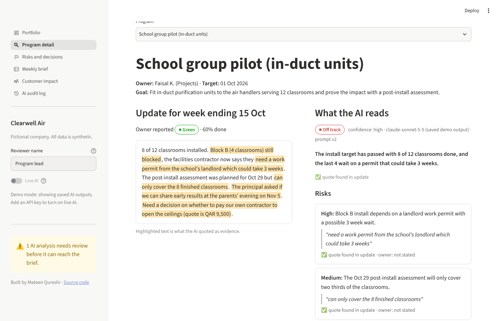
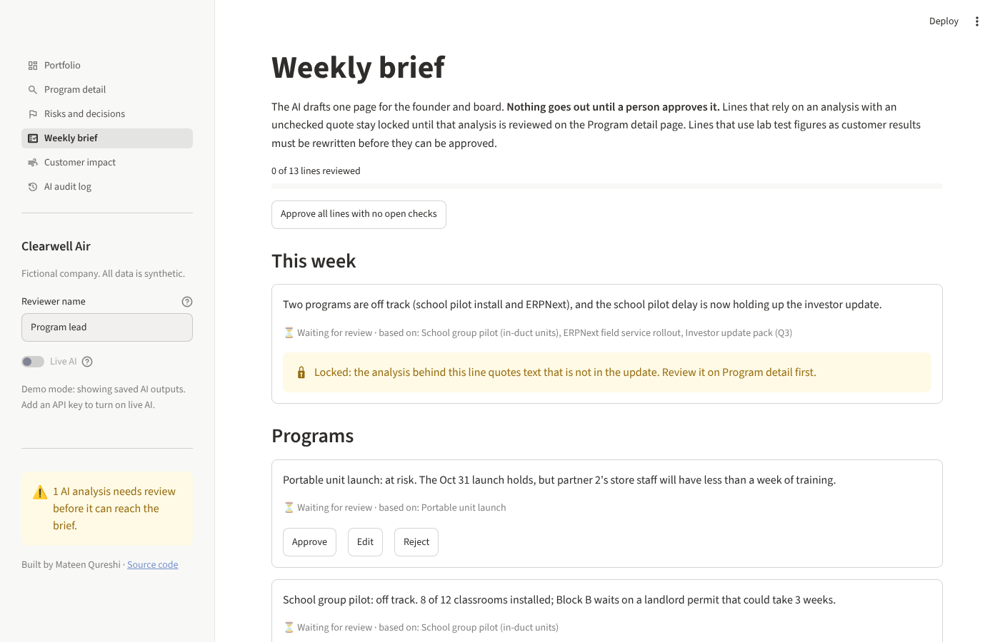

# Program Pulse

**AI status reporting with human sign-off, for a growing startup.**

Every week, program owners write a few lines on how things are going. Most of them report green. Program Pulse reads what they actually wrote, says what the text really supports, and shows the quote behind every call. Plain rules watch the history for drift. A person approves each line before anything reaches the founder or the board.

**[Live demo](https://YOUR-APP-NAME.streamlit.app)** · runs on saved AI outputs, so it is free to click around



## The story behind it

I built the first version of this while advising an indoor air quality startup in Doha that distributed a US-made purification technology in Qatar, both as in-duct units for HVAC systems and as portable purifiers, plus before-and-after building assessments that showed what the equipment did in real rooms. Mold is a constant problem in humid Gulf buildings, and indoor air quality is part of Qatar's national environment strategy, so schools, clinics and offices were the core customers. The team was small, everyone was running several things at once, and the founder needed one honest page each week for investor and customer conversations.

This repo is a clean rebuild with best practices. **The company, people and numbers here are fictional** ("Clearwell Air"), but the problems are the real ones:

- A school pilot reported **green for five straight weeks** while four classrooms sat blocked behind a ceiling access problem.
- An ERP rollout said **"almost done" for five weeks** and sat at 85% for four of them.
- An import shipment stuck at customs threatened a **product launch in a different program**.
- The investor update depended on **results that would arrive after the send date**.
- Brochure lab figures (99.99% in a sealed chamber) kept creeping into **customer and investor material**, where only field results belong.

## What it does

| Page | What you see |
|---|---|
| **Portfolio** | All programs, the owner's color next to the AI's reading, and drift flags. Green reports with risky text get called out. |
| **Program detail** | The raw update with the AI's evidence highlighted, every risk and decision with its source quote, and a check mark or warning showing whether the quote is really there. |
| **Risks and decisions** | A risk register and decision log pulled from the week's updates, filterable and downloadable. |
| **Weekly brief** | An AI-drafted page for the founder and board. Each line needs Approve, Edit or Reject. Only approved lines are exported. |
| **Customer impact** | Before-and-after field results (mold, VOCs, PM2.5, CO2) from the assessment service, side by side with the lab-versus-field gap, including where a product does *not* help. |
| **AI audit log** | Every AI suggestion and every human action on it, with model and prompt version. |



## How the AI is kept honest

This is the part I care most about. The full write-up is in [docs/ai-governance.md](docs/ai-governance.md).

1. **Evidence or it does not count.** The AI must back every status, risk and decision with an exact quote. Code checks the quote exists in the update.
2. **Unchecked work is locked.** If a quote fails the check, the brief lines that depend on it are locked until a person reviews the analysis.
3. **A person signs off.** Nothing reaches the board without a named reviewer approving it.
4. **Structured output only.** The model answers through a forced tool call with a fixed schema, then every field is validated.
5. **Everything is traceable.** Model name and prompt version travel with every output and audit entry.
6. **Rules where rules work.** Drift detection is plain code, not AI, so every flag can be explained in a meeting.
7. **Field results, not lab claims.** A brief line that presents a lab-style figure (99.99%, 4-log, "within 3 minutes") as a customer result cannot be approved until it is rewritten with field data or labelled as a lab result.

The demo data includes **two deliberate mistakes** so you can watch the controls work: a made-up quote in the investor update analysis (open Program detail and pick the investor update), and a brief line claiming "99.99% of mold at customer sites" (open Weekly brief).



## Built with

- **Python** and **Streamlit** for the app
- **Claude API** (Anthropic) for reading updates and drafting the brief
- **Pydantic** for data validation, **Altair** for charts
- **pytest** (44 tests, including end-to-end app tests) and **Ruff**, run on every push by **GitHub Actions**

Architecture and design choices: [docs/architecture.md](docs/architecture.md)

## Run it yourself

You need Python 3.11 or newer.

```bash
git clone https://github.com/YOUR-GITHUB-USERNAME/iaq-program-pulse.git
cd iaq-program-pulse
pip install -r requirements.txt
streamlit run streamlit_app.py
```

The app opens in demo mode. To try **Live AI**, copy `.streamlit/secrets.toml.example` to `.streamlit/secrets.toml`, add your Anthropic API key, restart, and switch on Live AI in the sidebar. You can then re-run the AI on any update or paste your own.

Run the checks:

```bash
pip install -r requirements-dev.txt
pytest -q
ruff check .
```

## Project layout

```
streamlit_app.py          app entry point and navigation
views/                    one file per page
pulse/                    the logic: models, AI calls, grounding, drift rules, brief, audit
data/                     synthetic programs, updates, assessments and saved AI outputs
scripts/                  regenerate saved AI outputs with the live API
tests/                    unit and app tests
docs/                     architecture and AI governance notes
```

## What I would add next

- Collect updates from a simple form or Slack instead of a file
- Store updates, analyses and the audit log in a database
- Email the approved brief every Thursday
- A labelled test set to score the AI each time the prompt changes

## About

Built by **Mateen Qureshi**, transformation and program governance lead with 20 years in financial services and startup operations across the US and GCC. [LinkedIn](https://www.linkedin.com/in/mateenaddsvalue)

Licensed under MIT. All company names, people, sites and figures in this repository are fictional.
