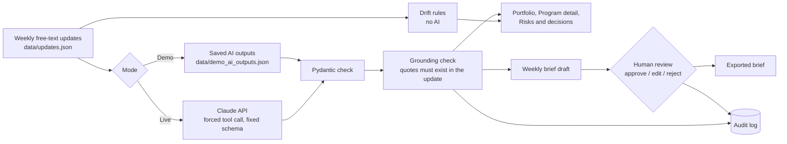

# Architecture

Program Pulse is a small Streamlit app. All logic that matters lives in the `pulse/` package so it can be tested without a browser. The screens in `views/` only arrange that logic on the page.

## Modules

| Module | Job |
|---|---|
| `pulse/models.py` | Data shapes. Every record from a file or the API is checked against these. |
| `pulse/data.py` | Loads the synthetic data files. |
| `pulse/prompts.py` | All prompt text and the output schema, with a version number. |
| `pulse/ai.py` | The only module that calls Claude. Forces a tool call so replies are always structured. |
| `pulse/grounding.py` | Checks that every quote the AI gives as evidence is really in the update. |
| `pulse/drift.py` | Plain rules on the update history: stalled progress, "almost done" loops, missed dates, silence, green-but-risky. |
| `pulse/brief.py` | Builds the exported brief from approved lines only, and locks lines tied to unchecked analyses. |
| `pulse/audit.py` | Records every AI suggestion and every human action on it. |
| `pulse/ui.py` | Shared page setup, sidebar, session state and status badges. |

## Design choices

**Why the AI answers through a tool call.** Asking for JSON in plain text works most of the time. Forcing a tool call with a schema works every time, and the reply is then validated by Pydantic. A bad reply fails loudly instead of showing wrong data.

**Why drift detection is not AI.** The rules look at six weeks of history and need to be explainable to a program owner who disagrees with a flag. A regular expression for "almost done" is easy to defend in a meeting. The AI only reads one update at a time.

**Why demo mode exists.** A public demo link should work for anyone, cost nothing and show the same thing every time. Saved outputs do that. `scripts/refresh_demo_outputs.py` regenerates them with the live API when prompts change.

**Why session-only audit storage.** The hosted demo has no database, and visitors should not see each other's actions. A production version would write the same `AuditEntry` records to a database table without changing the rest of the code.

## What a production version would add

- Updates collected from a form, Slack or email instead of a JSON file
- A database for updates, analyses and the audit log
- Sign-in, so the reviewer name comes from the login rather than a text box
- Scheduled weekly runs and an email of the approved brief
- A small labelled test set to measure the AI's accuracy each time the prompt changes
